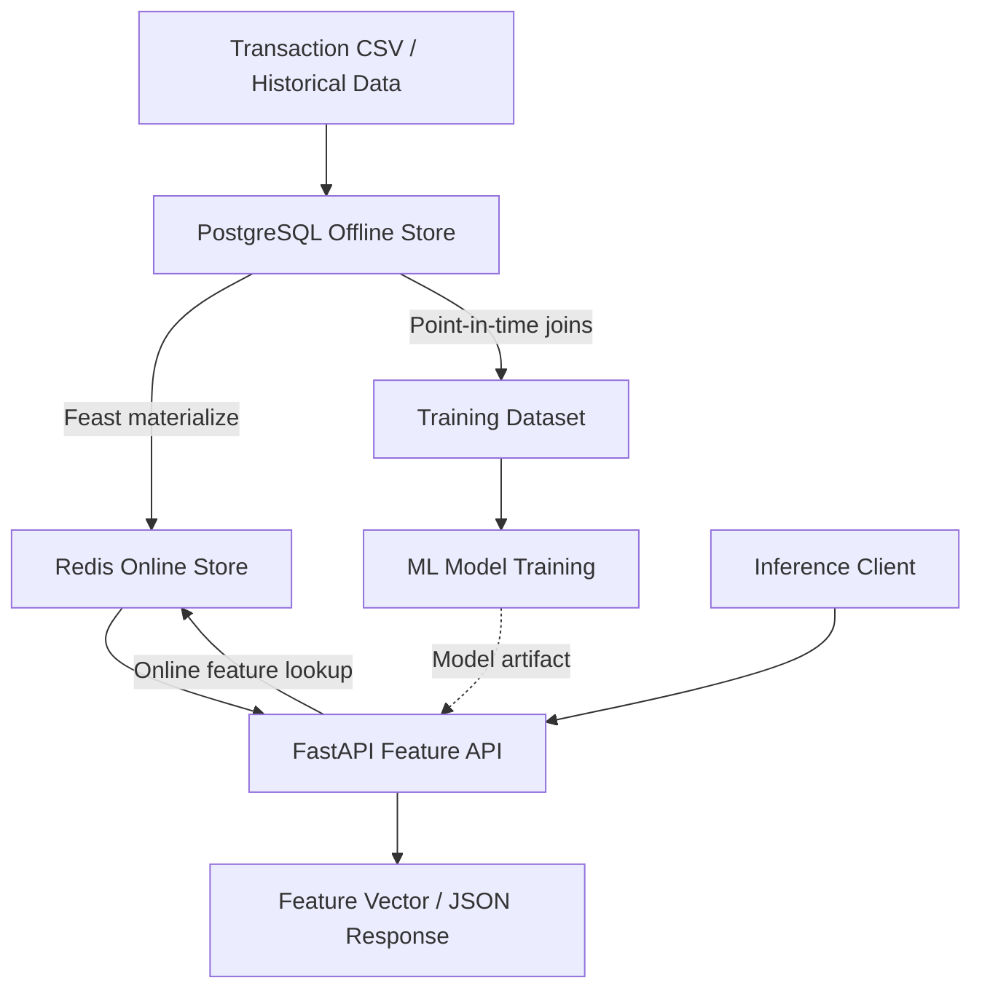

# Low-Latency Feature Store & Real-Time MLOps Pipeline

A production-oriented MLOps infrastructure designed to reduce **training-serving skew** and enable low-latency feature retrieval for real-time machine learning inference.

This project integrates **Feast**, **PostgreSQL**, **Redis**, **FastAPI**, and **Docker Compose** to build a feature-serving pipeline that separates historical feature storage from online inference workloads.

> **Performance goal:** Sub-5 ms online feature retrieval. Actual latency depends on deployment topology, network overhead, data size, and workload and should be validated through benchmarking.

## Architecture



### How it works

1. **Historical ingestion:** Transaction records are loaded into PostgreSQL.
2. **Feature definition:** Feast defines entities, data sources, and feature views.
3. **Offline retrieval:** Feast performs point-in-time-correct joins to generate historical training data.
4. **Materialization:** Feast synchronizes feature values from the offline store into Redis.
5. **Online serving:** FastAPI retrieves customer features from Redis for downstream inference requests.

## Technology Stack

| Component | Technology | Purpose |
|---|---|---|
| Feature store | Feast 0.40+ | Feature definitions, historical retrieval, and materialization |
| Offline store | PostgreSQL | Historical transaction records |
| Online store | Redis | Low-latency feature retrieval |
| API framework | FastAPI | REST endpoints for online feature serving |
| ASGI server | Uvicorn | Runs the FastAPI application |
| Data processing | Pandas | CSV ingestion and training-data preparation |
| Database connectivity | SQLAlchemy | PostgreSQL connectivity and SQL execution |
| Containerization | Docker | Application and infrastructure packaging |
| Orchestration | Docker Compose | Local multi-service deployment |
| Language | Python 3.11+ | Pipeline implementation |

## Core Features

### 1. Training-Serving Consistency

Feast provides a shared feature-definition layer for training and online serving.

The project uses the same feature definitions for historical extraction and online retrieval, helping reduce inconsistencies between training-time and inference-time features.

Example feature references:

- `ecommerce_features:amount`
- `ecommerce_features:quantity`

The feature names must match the actual feature view and schema registered in your Feast repository.

### 2. Point-in-Time Correctness

Feast's historical retrieval supports point-in-time joins that select feature values available at or before an entity's event timestamp.

This helps prevent future-data leakage when constructing training datasets.

### 3. Offline and Online Store Separation

- **PostgreSQL:** Retains historical data for analysis and training.
- **Redis:** Stores materialized feature values for online lookups.
- **Feast:** Coordinates feature definitions, retrieval, and synchronization.

This architecture avoids querying the entire historical dataset for every online inference request.

### 4. API-Based Feature Serving

FastAPI exposes HTTP endpoints for retrieving features. Downstream applications can request customer feature vectors without directly accessing Redis or PostgreSQL.

### 5. Containerized Infrastructure

Docker Compose simplifies local development by allowing services to be started and managed through a shared configuration.

## Project Structure

```text
train-skew-serve/
├── app/
│   ├── __init__.py
│   ├── main.py                 # FastAPI endpoints
│   └── database.py             # SQLAlchemy database connection
├── feature_store/
│   └── feature_repo/
│       ├── feature_store.yaml  # Feast configuration
│       ├── feature_definitions.py
│       └── data/               # Local feature data, if applicable
├── generate_training_data.py   # Historical feature extraction
├── inject_transaction.py       # CSV-to-PostgreSQL ingestion
├── Dockerfile                  # API container image
├── docker-compose.yml          # Service orchestration
├── requirements.txt            # Python dependencies
├── .env                        # Local environment variables
└── README.md
```

The structure above is illustrative; retain the filenames and locations that actually exist in your repository.

## Getting Started

### Prerequisites

Install the following before starting:

- Python 3.11 or later
- Docker Desktop and Docker Compose
- Git
- PostgreSQL configured as the Feast offline store
- Redis configured as the Feast online store

### 1. Clone the repository

```bash
git clone https://github.com/YOUR_USERNAME/train-skew-serve.git
cd train-skew-serve
```

Replace `YOUR_USERNAME` with the GitHub account hosting the repository.

### 2. Create a Python environment

**Windows PowerShell:**

```powershell
python -m venv venv
.\venv\Scripts\Activate.ps1
python -m pip install --upgrade pip
pip install -r requirements.txt
```

**Linux or macOS:**

```bash
python3 -m venv venv
source venv/bin/activate
python -m pip install --upgrade pip
pip install -r requirements.txt
```

If `requirements.txt` does not yet contain all dependencies, install the required packages for your configured Feast version, FastAPI, Uvicorn, SQLAlchemy, Pandas, PostgreSQL driver, and Redis client.

### 3. Configure environment variables

Create a `.env` file in the project root and configure your database credentials:

```dotenv
DB_HOST=127.0.0.1
DB_PORT=5432
DB_NAME=feature_store_db
DB_USER=postgres
DB_PASSWORD=replace_with_your_password
```

Configure Redis and any other application-specific variables required by your implementation.

**Security notes:**

- Never commit real credentials or API keys.
- Add `.env` and `venv/` to `.gitignore`.
- If the API runs inside Docker Compose, use the PostgreSQL or Redis **service name** as the hostname when connecting to another container on the same network, rather than `127.0.0.1`.
- Keep credentials consistent with the actual Docker and Feast configurations.

### 4. Ingest transaction data

If your dataset has not yet been loaded into PostgreSQL, run your ingestion script:

```bash
python inject_transaction.py
```

This script should load the transaction CSV, normalize timestamp columns, and insert the records into the configured PostgreSQL table.

Verify that the expected table and columns exist before proceeding.

### 5. Apply the Feast repository

Navigate to the directory containing `feature_store.yaml`:

```bash
cd feature_store/feature_repo
feast apply
```

Return to the project root afterward:

```bash
cd ../..
```

Feast registers the configured entities, data sources, and feature views. Resolve any schema, import, or connection errors before moving to materialization.

### 6. Generate historical training data

Run the historical feature extraction script from the project root:

```bash
python generate_training_data.py
```

The script should use Feast's historical retrieval functionality to produce a training dataset, such as `training_data.csv`.

Ensure the script uses the correct entity keys, event timestamps, and feature references defined in the Feast repository.

### 7. Materialize features into Redis

Use a materialization interval appropriate for your dataset and Feast configuration. For example, from the Feast repository directory:

```bash
cd feature_store/feature_repo
feast materialize-incremental "$(python -c "from datetime import datetime, timezone; print(datetime.now(timezone.utc).isoformat())")"
cd ../..
```

This command materializes eligible historical feature values up to the current time. Ensure your Redis online store is running and configured correctly.

For a repeatable production pipeline, schedule incremental materialization or trigger it as part of your ingestion workflow.

### 8. Start the API and infrastructure

From the project root:

```bash
docker compose up --build -d
```

Check the running services:

```bash
docker compose ps
```

Inspect logs if a service fails:

```bash
docker compose logs -f
```

Make sure the Docker Compose configuration includes the required API and Redis services and that the API can connect to Redis. PostgreSQL must also be reachable by whichever component uses it.

If you prefer to run the API directly from your local Python environment during development:

```bash
python -m uvicorn app.main:app --reload
```

Do not run two API instances on the same host port simultaneously.

## API Usage

Once the API is running, open the interactive documentation:

**Swagger UI:** [http://localhost:8000/docs](http://localhost:8000/docs)

### Retrieve customer features

Example request:

```http
GET /features/13069
```

Using `curl`:

```bash
curl http://localhost:8000/features/13069
```

Example response shape:

```json
{
  "customer_id": 13069,
  "features": {
    "amount": 125.5,
    "quantity": 3
  }
}
```

This response is illustrative. Actual field names, data types, and response structure must match your FastAPI implementation and Feast feature definitions.

### Check database health

If your application exposes a database health endpoint:

```bash
curl http://localhost:8000/health/db
```

### Fetch transaction records

If your application exposes a transaction endpoint:

```bash
curl "http://localhost:8000/transactions?limit=10"
```

The transaction endpoint is useful for validating database ingestion. The feature endpoint should retrieve materialized features from Redis through the configured online feature store.

## Performance and Validation

The target is sub-5 ms online feature retrieval. Treat this as a performance objective until measured under a defined workload.

Recommended validation steps:

1. Measure feature lookup latency separately from HTTP response latency.
2. Test warm and cold Redis access.
3. Benchmark concurrent requests.
4. Record p50, p95, and p99 latency.
5. Test missing entity keys and missing feature values.
6. Verify that the API does not fall back to slow historical queries during normal online serving.
7. Validate feature freshness after incremental materialization.

Network topology, serialization, connection pooling, and system load can all affect observed latency.

## Troubleshooting

| Problem | What to check |
|---|---|
| PostgreSQL connection failure | Credentials, port mapping, container health, and database hostname |
| Feast cannot find its configuration | Run Feast commands from the directory containing `feature_store.yaml` |
| Missing feature values | Entity keys, feature references, materialization range, and Redis connectivity |
| Redis connection refused | Redis container status, exposed port, and configured hostname |
| API returns 500 errors | Inspect Uvicorn logs and verify dependencies and environment variables |
| Historical training data contains leakage | Check event timestamps and confirm point-in-time retrieval is used |
| Slow feature retrieval | Benchmark Redis operations, API overhead, network latency, and connection pooling |

## Future Improvements

- Add an ML inference endpoint that combines online feature retrieval with a saved model.
- Add structured logging and request tracing.
- Implement API authentication and rate limiting.
- Add automated tests for feature retrieval and database integration.
- Introduce metrics and dashboards for latency, errors, and feature freshness.
- Automate ingestion, validation, materialization, and model deployment through CI/CD.
- Add load testing to establish verified latency and throughput benchmarks.

## License and Attribution

Add a license that reflects how this project may be used and redistributed. If this project builds upon existing open-source work, preserve the applicable license terms, copyright notices, and attribution requirements.

---

**Built with Python, Feast, PostgreSQL, Redis, FastAPI, and Docker.**
